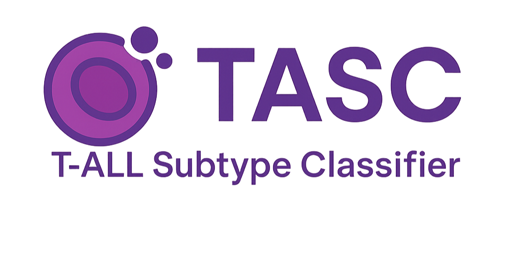
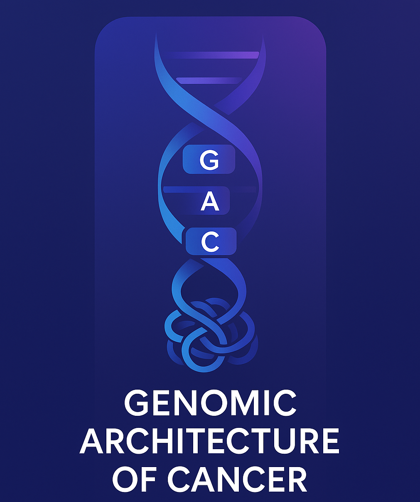

# TASC

### We are on biorxiv !
[Read more](https://www.biorxiv.org/content/10.64898/2025.12.23.696007v1) about how we developed and applied TASC on our multi-omic cohort. 

## Get started
Run our [ShinyApp](https://01971d1c-d81d-a598-4238-5afb7b3e381a.share.connect.posit.cloud/) for an interactive and reproducible framework to classify your T-ALL samples into multi-omic subtypes based on transcriptomic profiles. 
Check out our [Guide](guide.md) to learn how to run TASC and for support for local use of the app, or start using it [immediately](QuickStart.md)

### Authors
[Cinzia Benetti](mailto:cinzia.benetti@ircc.com)

### Genomic Architecture of Cancer Lab
#### Dr. Francesco Boccalatte, PhD  

   Visit our
    <a href="https://inoc.it/it/laboratori/genomic-architecture-of-cancer/#research-topic" target="_blank" style="text-decoration: none">
    website
    </a>
  
  

